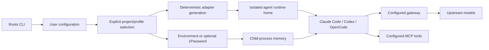

# Architecture and ownership

Roots is a configuration compiler and process launcher. It owns reusable behaviour, while users
own their instructions, credentials, endpoint choices and project mappings. A model gateway owns
model routing and billing; the coding agent owns its tools, approvals, helpers and transcript state.

## Source map

| Module | Responsibility |
|---|---|
| `bin/roots.mjs` | Executable entry point |
| `src/cli.mjs` | Command parsing, orchestration and user output |
| `src/config.mjs` | Validation, project selection, runtime identity and atomic writes |
| `src/credentials.mjs` | Credential resolution and launch-environment cleanup |
| `src/adapters.mjs` | Native tool files, environment and argument generation |
| `src/sync.mjs` | Idempotent generated-file writes and skills links |
| `src/mcp.mjs` | Canonical MCP validation and profile selection |
| `bin/roots-mcp.mjs` | Stdio wrapper with a server-specific mapped environment |
| `src/process.mjs` | Executable discovery, shell-free launch and signal handling |
| `src/http.mjs` | Bounded HTTP with secret-safe failure messages |
| `src/models.mjs` | Project-scoped model discovery and ID caches |
| `src/scout.mjs` | Changelog baselines, pending work, optional proposals and local reports |
| `src/status.mjs` | Observation of Roots-launched session records |
| `test/` | Dummy-credential and filesystem/HTTP/process regression coverage |

## Generated versus native files

All generated files live below `ROOTS_HOME/state/runtimes/<profile>/<identity>/<tool>/`.
Sync does not edit the usual global `~/.claude`, `~/.codex` or `~/.config/opencode` setup.

| Agent | Roots writes | Launch selection | Native state ownership |
|---|---|---|---|
| Codex | `roots.config.toml`, `AGENTS.md`, skills link | `CODEX_HOME`, `--profile roots`, `--no-daemon` | Base `config.toml`, trust, history and native state stay in that home |
| Claude Code | `roots.settings.json`, `roots.mcp.json`, `CLAUDE.md`, skills link | `CLAUDE_CONFIG_DIR`, explicit settings and strict MCP configuration | Base settings, history and native state stay in that home |
| OpenCode | `opencode.json`, skills link | Custom config and profile-scoped XDG locations | Native data, state and cache are directed to the runtime's XDG folders |

The runtime identity changes when routing or credential references change. Old homes are retained
for the user to inspect; there is no automatic cleanup of native sessions or reports.

## Secrets and external traffic

Roots stores source references, model IDs, timestamps, process IDs and report paths. It does not
record prompts or resolved credentials. Native tools and MCP servers have their own logging and
secret-handling behaviour; a launcher cannot control that by itself.

Each launch also stores a reference-only MCP snapshot under `state/mcp-snapshots/`. The stdio wrapper
uses that snapshot rather than rereading mutable source definitions, so an existing session retains
the server/credential mapping selected at launch. Snapshots contain no resolved credential values.

No implicit network/model calls happen during `init`, `sync`, `status`, local skill import or launch
preparation. The agent makes its normal model calls after launch. Explicit `models` and
`doctor --online` query the configured gateway. Scout fetches configured public URLs; only
`scout run --review` sends their text to the configured review model.

Roots does not forward conversation history to search services and does not implement a search gateway.
It declares native search support only when a user explicitly configures the capability.

## Extension boundaries

Gateway authentication and model metadata can be extended independently of agent adapters.
Additional adapters need evidence for endpoint routing, credential precedence and isolated state.
Scheduling and reports use normal CLI/filesystem boundaries, so an external task scheduler or
report consumer can integrate without introducing a mandatory desktop app or note-taking product.
